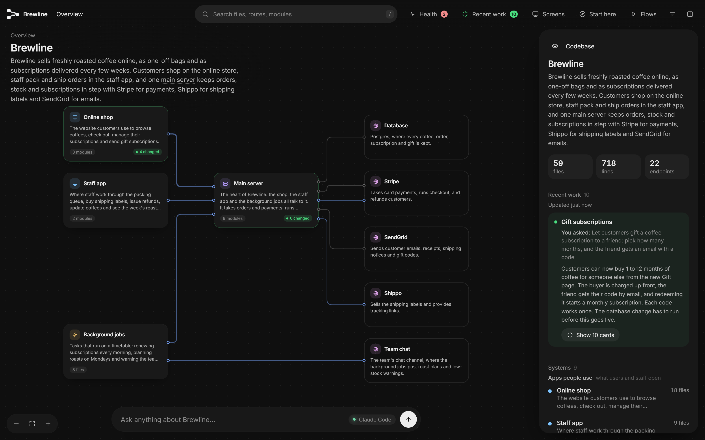
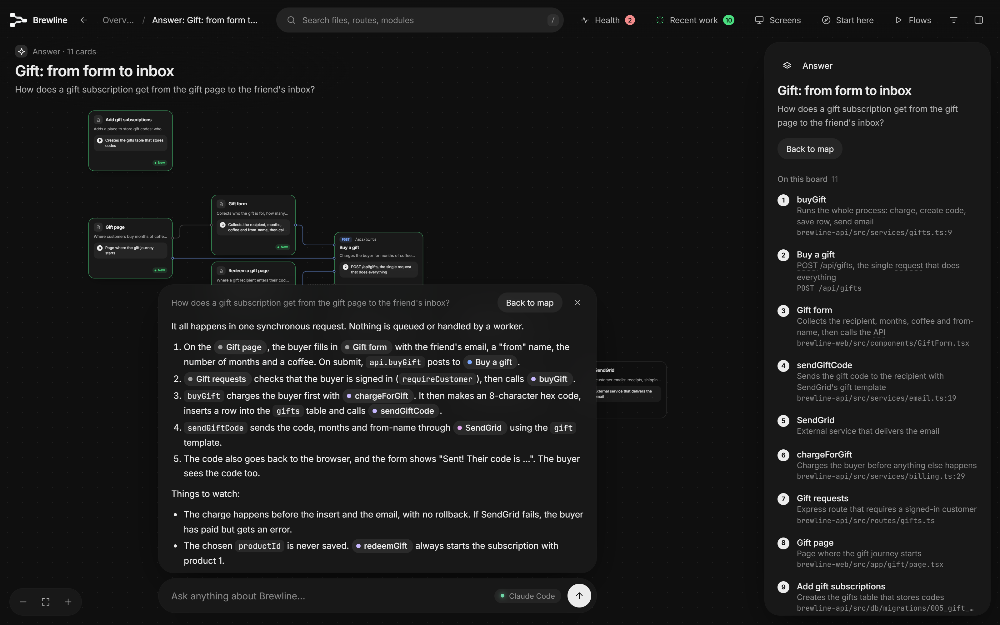
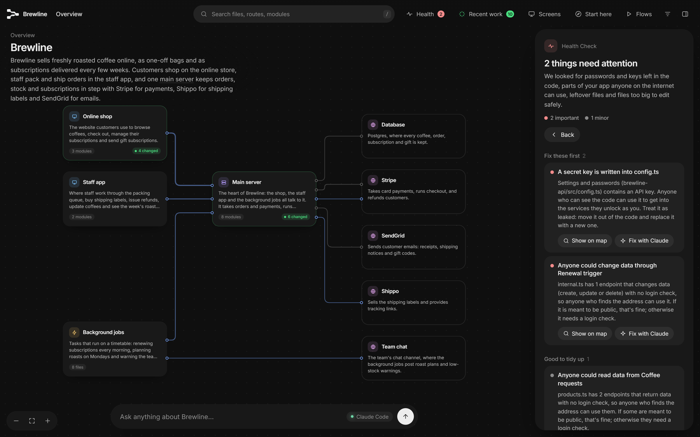

# Floorplan for ZCode

An interactive, plain-English map of your codebase — drawn by [ZCode](https://z.ai) as a single
self-contained `floorplan/index.html` you can open in any browser.

Every subsystem, file and HTTP route gets a human name and a one-line description, connected by
the imports and web requests between them, with a health check, screens, guided flows and an Ask
bar that answers questions through the **ZCode CLI's read-only plan mode** — no Claude Code or
Codex installation needed.



## What it does

- **Map** — subsystems, modules, files, endpoints and cross-repo request/response connections,
  named and described in plain language, at several zoom levels.
- **Health check** — flags secrets hard-coded in source, endpoints anyone can change, weak
  Supabase/Firebase rules, unchecked Stripe webhooks, dead files and god-files (values never
  stored, only locations and masked hints).
- **Screens** — what sits behind each app screen: components, the requests they make, the server
  code and data that answer them.
- **Ask the map** — "How does a refund reach the customer's card?" answered with cards, notes and
  a step-by-step walkthrough, backed by your real code (read-only).
- **Blueprints** — share a PRD before any code exists and get the same map planned from it.
- **Export** — one HTML file to share, stripped of local paths, with no Ask bar and no network.




## Install

1. Clone this repository (or download and unpack it):

   ```sh
   git clone https://github.com/<you>/zcode-floorplan.git
   ```

2. In ZCode, open **Plugin Marketplace → Add → Add Plugin Marketplace** and paste the path to the
   cloned folder (the one containing `marketplace.json`). Some ZCode versions also accept a git
   URL directly — try it; if it isn't supported, the cloned folder always works.
3. Open **Personal → Floorplan for ZCode → Floorplan** and click **Install**.
4. Requirements: Node 18+ on your `PATH` (the skill's scripts are plain Node with zero npm
   dependencies), and ZCode itself for the Ask bar.

## Use it

Open a project in ZCode and ask:

> Make me a floorplan of this app

or, after more work:

> Update the floorplan

You get a URL like `http://127.0.0.1:4378` — the map opens in your browser, with a report of the
architecture and any high-severity health findings. Share a copy with the map's **Export** button.

## How the Ask bar picks its model

Ask runs `zcode --prompt … --mode plan` (read-only) in your codebase. The ZCode CLI answers with
the **first provider in your provider list** and that provider's **first model** — it does not use
the model selected in a ZCode chat session, and it has no per-run model flag. If that provider is
unreachable (for example a local LM Studio that is off), the Ask bar shows the error; put a
reachable provider first in ZCode's provider settings, or start the model host.

## Provenance and attribution

This is a **ZCode packaging of [Floorplan](https://github.com/haydenschmitty/floorplan)**
(v0.8.0), by **Hayden Smith** — an MIT-licensed Claude Code / Codex plugin with ~4k stars. All
scanner, parser, health-check, rendering and server code is upstream work, reused under the MIT
license; the interactive map and its design are entirely Hayden's.

What was changed for ZCode (see `git log` for details):

- `SKILL.md` — script paths use `${ZCODE_PLUGIN_ROOT}`, maps are built with `--agent none`, and
  the Claude Code-specific bits (CLAUDE.local.md notes, "Fix with Claude" prompts) are dropped.
- `assets/serve.mjs` — added a `zcode` engine: questions run through `zcode --prompt` in its
  read-only plan mode, with session resume via `--resume`; search order is zcode → claude → codex.
- `assets/viewer.html`, `assets/ui/50-cloud.js` — the page names and labels the ZCode agent.
- `scripts/open.mjs` — engine passthrough and naming.

Upstream's release integrity check applies to everything except the files listed above:
`node tools/checksums.mjs --check` against upstream `CHECKSUMS.txt` still matches the untouched
majority. Images in `docs/images/` are also from the upstream repository (MIT).

Upstream README, docs and the security analysis that shaped this packaging live at
[haydenschmitty/floorplan](https://github.com/haydenschmitty/floorplan) — start with
[docs/is-it-safe.md](https://github.com/haydenschmitty/floorplan/blob/main/docs/is-it-safe.md).

## Safety

- Zero npm dependencies, no install scripts, no hooks, no MCP servers — the plugin is only a skill.
- The map page loads nothing from the internet (fonts and the layout engine are vendored); an
  exported copy cannot contact anything (CSP `connect-src: 'none'`).
- The local map server listens on `127.0.0.1` only, checks the `Host` header and answers API
  calls only with a session token.
- Ask runs read-only (plan mode) on your own ZCode sign-in, in the codebase root.
- One upstream outbound call remains: an opt-in waitlist signup, only if you click "Notify me" on
  the map. Everything else stays local.

## License

MIT — © Hayden Smith for the original Floorplan, © the ZCode packaging authors for the
adaptations. See [LICENSE](LICENSE) and [floorplan/LICENSE](floorplan/LICENSE).
