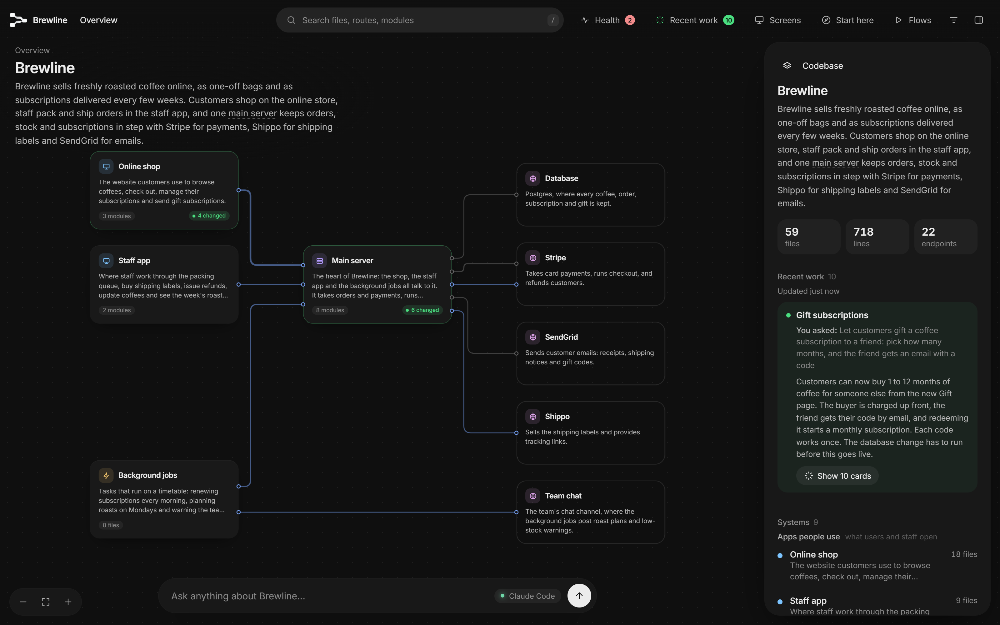
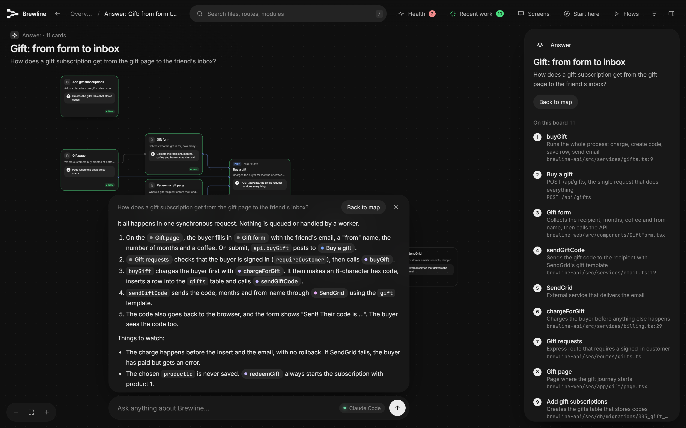
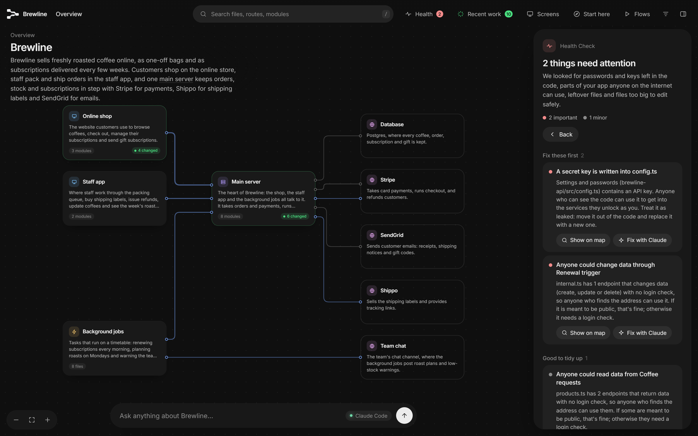

# Floorplan для ZCode

[🇬🇧 English](README.md) · 🇷🇺 Русский

Интерактивная карта вашей кодовой базы «человеческим языком», которую [ZCode](https://z.ai)
строит в виде одного самодостаточного файла `floorplan/index.html`, открывающегося в любом браузере.

Каждая подсистема, файл и HTTP-роут получают человеческое имя и описание в одну строку, связанные
импортами и веб-запросами между собой, плюс проверка здоровья (health check), экраны приложения,
пошаговые сценарии (flows) и Ask-бар, который отвечает на вопросы через **read-only plan-режим
ZCode CLI** — установка Claude Code или Codex не нужна.



## Что это умеет

- **Карта** — подсистемы, модули, файлы, эндпоинты и связи «запрос → ответ» между репозиториями,
  с именами и описаниями простым языком, на нескольких уровнях масштаба.
- **Проверка здоровья** — находит секреты, захардкоженные в коде, эндпоинты, доступные любому,
  слабые правила Supabase/Firebase, Stripe-вебхуки без проверки подписи, мёртвые файлы и
  «файлы-бог» (значения секретов не сохраняются — только место и замаскированная подсказка).
- **Экраны** — что стоит за каждым экраном приложения: компоненты, их запросы, серверный код и
  данные, которые на них отвечают.
- **Спросить карту** — «Как возврат доходит до карты клиента?» с карточками, заметками и
  пошаговым разбором, опираясь на ваш реальный код (только чтение).
- **Blueprints** — покажите PRD до того, как код написан, и получите ту же карту, спланированную
  по документу.
- **Экспорт** — один HTML-файл для передачи другим: без локальных путей, без Ask-бара, без сети.




## Установка

1. Склонируйте репозиторий (или скачайте и распакуйте):

   ```sh
   git clone https://github.com/sergeymaslov/zcode-floorplan.git
   ```

2. В ZCode откройте **Plugin Marketplace → Add → Add Plugin Marketplace** и вставьте путь к
   склонированной папке (той, где лежит `marketplace.json`). Некоторые сборки ZCode принимают и
   git-URL напрямую — попробуйте; если нет, локальная папка работает всегда.
3. Откройте **Personal → Floorplan for ZCode → Floorplan** и нажмите **Install**.
4. Требования: Node 18+ на вашем `PATH` (скрипты скилла — чистый Node без npm-зависимостей), и сам
   ZCode для Ask-бара.

Примечания:

- После установки начните новый таск и либо выберите скилл **Floorplan** в пикере композера, либо
  просто попросите построить floorplan (см. ниже). Установленный плагин управляется в
  **Settings → Plugins**.
- Если у вас уже стоит плагин `floorplan` из другого маркетплейса (например, dev-копия), сначала
  выключите или удалите его — один и тот же plugin id из двух источников только путает.
- Обновление позже: обновите рынок (кнопка-шестерёнка → **Refresh**), затем нажмите **Update** у
  плагина в **Personal**. Установленная копия сама за репозиторием не следует.

## Как пользоваться

Откройте проект в ZCode и попросите:

> Сделай floorplan этого приложения

или, после доработок:

> Обнови floorplan

Вы получите ссылку вида `http://127.0.0.1:4378` — карта откроется в браузере, вместе с описанием
архитектуры и находками health check высокой важности. Поделиться копией — кнопка **Export** на карте.

## Как Ask-бар выбирает модель

Ask выполняет `zcode --prompt … --mode plan` (только чтение) в вашей кодовой базе. ZCode CLI
отвечает через **первого провайдера из вашего списка** и его **первую модель** — модель, выбранная
в чате ZCode, он не использует, и флага выбора модели у headless-запуска нет. Если этот
провайдер недоступен (например, локальный LM Studio выключен), Ask-бар покажет ошибку; поставьте
доступного провайдера первым в настройках провайдеров ZCode или включите хост с моделью.

## Происхождение и атрибуция

Это **упаковка [Floorplan](https://github.com/haydenschmitty/floorplan)** (v0.8.0) для ZCode.
Автор оригинала — **Hayden Smith**, плагин для Claude Code / Codex под лицензией MIT (~4k звёзд).
Весь код сканера, парсеров, health check, рендеринга и сервера — работа апстрима, переиспользуемая
по MIT; интерактивная карта и её дизайн — целиком заслуга Hayden'а.

Что изменено для ZCode (подробности в `git log`):

- `SKILL.md` — пути к скриптам через `${ZCODE_PLUGIN_ROOT}`, карты строятся с `--agent none`,
  специфичные для Claude Code вещи (заметки в CLAUDE.local.md, подсказки «Fix with Claude») убраны.
- `assets/serve.mjs` — добавлен движок `zcode`: вопросы идут через `zcode --prompt` в read-only
  plan-режиме, с продолжением диалога через `--resume`; порядок поиска: zcode → claude → codex.
- `assets/viewer.html`, `assets/ui/50-cloud.js` — страница называет агента ZCode и показывает
  соответствующие подписи.
- `scripts/open.mjs` — проброс движка и имена.

Проверка целостности релиза апстрима применима ко всему, кроме перечисленных выше файлов:
`node tools/checksums.mjs --check` против апстримного `CHECKSUMS.txt` совпадает на нетронутой
большинстве файлов. Картинки в `docs/images/` тоже из репозитория апстрима (MIT).

README, документация и разбор безопасности апстрима — в
[haydenschmitty/floorplan](https://github.com/haydenschmitty/floorplan); начните с
[docs/is-it-safe.md](https://github.com/haydenschmitty/floorplan/blob/main/docs/is-it-safe.md).

## Безопасность

- Ноль npm-зависимостей, нет install-скриптов, хуков и MCP-серверов — плагин это только скилл.
- Страница карты не загружает ничего из интернета (шрифты и движок раскладки вендорены); экспорт
  не может связаться ни с чем (CSP `connect-src: 'none'`).
- Локальный сервер карты слушает только `127.0.0.1`, проверяет заголовок `Host` и отвечает на API
  только с токеном сессии.
- Ask работает в режиме «только чтение» (plan) от вашего входа в ZCode, в корне кодовой базы.
- Остаётся один исходящий вызов из апстрима: добровольная запись в waitlist — только если вы сами
  нажмёте «Notify me» на карте. Всё остальное остаётся локальным.

## Лицензия

MIT — © Hayden Smith за оригинальный Floorplan, © авторы упаковки для ZCode за адаптации. См.
[LICENSE](LICENSE) и [floorplan/LICENSE](floorplan/LICENSE).
